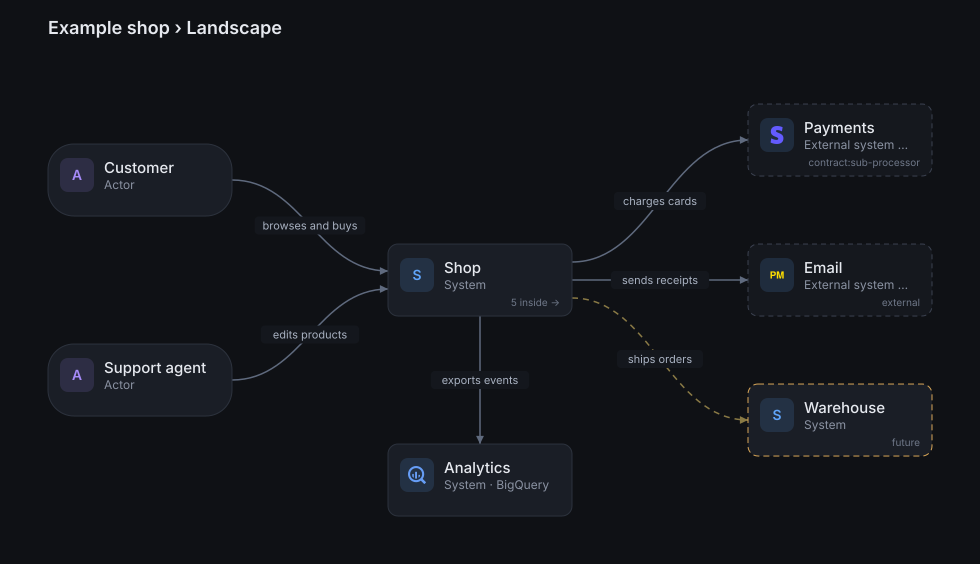

# Archnemesis: an architecture diagram tool for people and AI agents

Archnemesis (command: `archnm`) is an open source, self-hosted tool for drawing software
architecture with other people and with AI agents at the same time. You keep one model of
your systems (actors, systems, apps, stores, components, and the connections between them,
in the spirit of the C4 model) and draw as many diagrams from it as you like. Everything is
saved as plain YAML files, so your diagrams live in git, and an agent can read and change
them through an MCP server or by editing the files.



## See it work

Fastest first.

1. **Open the hosted demo.** It runs in your browser and keeps designs in your browser only.
   <https://ezekielenns.github.io/archnemesis/>
2. **Run it with Docker.** One command, nothing to build. Needs Docker.

   ```sh
   docker run -p 127.0.0.1:5190:5190 -v archnm-data:/data -e ARCHNM_AUTH=local -e ARCHNM_ALLOW_OPEN=yes ghcr.io/ezekielenns/archnemesis:main
   ```

   Open http://127.0.0.1:5190. This is for you alone: it answers only on your own machine and
   has no sign-in. Your designs are kept in the `archnm-data` volume. To host it for other
   people, with sign-in, see [Docker](#1-docker-the-default).

3. **Run it from source.** Needs Node 24 or newer and pnpm.

   ```sh
   git clone https://github.com/EzekielEnns/archnemesis.git && cd archnemesis
   ```

   ```sh
   pnpm install
   ```

   ```sh
   pnpm dev
   ```

   Open http://127.0.0.1:5190. It listens on loopback only and trusts whoever reaches it, so
   there is no sign-in.

Either way it starts with a small example shop to click around in. Double-click a box to open
what is inside it; `?` in the app lists the keys. From source, designs are written as folders
under `data/designs/` (`ARCHNM_ROOT` moves them, for example into a git repo) and live state
is in `data/archnm.sqlite` (`ARCHNM_DB`); both are gitignored here.

## What you can do with it

- Draw a system as boxes inside boxes, open any box to see what is inside it, and make as
  many views of the one model as you need (a landscape, one system, one app).
- Edit the same diagram live with teammates and agents at the same time.
- Keep the diagrams in a git repo as YAML, review a change as a pull request, and run
  `archnm check` in a pull request gate.
- Ask an AI agent, such as Claude Code or any other MCP client, to map a repo into the
  diagram (modules, functions, calls, libraries), or to plan a feature on a fork of it.
- Tell a story step by step over the same boxes with flows, and attach notes, comments and
  decisions to boxes and arrows.
- Render any view to PNG or SVG from the command line.

Contents: [See it work](#see-it-work) · [For AI agents](#for-ai-agents) ·
[Three ways to run it](#three-ways-to-run-it) · [Sign-in](#sign-in) ·
[Designs are files in git](#designs-are-files-in-git) ·
[Connecting an agent](#connecting-an-agent) · [The CLI](#the-cli) · [Settings](#settings) ·
[Development](#development) · [Upgrading from atlas](#upgrading-from-atlas)

## For AI agents

Archnemesis holds one software architecture that people and agents edit together, live: boxes
(actor, system, app, store, component; for code, module, function, library, table) nested with
`in`, connections between them, views and flows. It is saved as YAML in git, and that file
grammar is also how you write.

**Connect.** On a server install the MCP endpoint (streamable HTTP) is `<server>/mcp`, for
example `http://127.0.0.1:5190/mcp`. For Claude Code:

```sh
claude mcp add -s user --transport http archnm http://127.0.0.1:5190/mcp
```

On a server that needs a token add `--header "Authorization: Bearer <agent token>"`, where
`<agent token>` is a token from the server's `ARCHNM_TOKENS` file or a personal token made in
the app. The hosted demo has no server and so no `/mcp`: see
[Use an agent on the demo](#use-an-agent-on-the-demo). More in
[Connecting an agent](#connecting-an-agent).

**Tools** (defined in `shared/tools/tools.ts`):

- `read`: look at the design: search (`q`), one thing in full (`ref`), a brief for one box
  (`scope`), views, lenses such as `problems`, history, and what the person sees.
- `write`: change the design with a YAML fragment merged by id; `dry_run` first. It reports
  every problem at once and applies nothing if there is an error.
- `note`: notes, flags (something wrong or missing) and claims (what you learned about a box
  you do not own).
- `show`: move what the person sees (open, spotlight, tour) or render a view as a picture;
  changes nothing in the design.
- `guide`: the grammar, the field reference and playbooks (map, design, tour, mentor).
- `design`: list, create, fork, propose, delete and discard designs and forks.
- `index`: map a repo on the person's machine: start, scan, import.
- `feedback`: tell the maintainers when a tool got in your way.

**The loop.** Read, then dry-run a write, then write, then check for problems, then propose:

```text
read {q: "checkout"} → read {ref: "<box id>"} → write {dry_run: true, yaml: "<fragment>"} → write {apply: "<dry-run id>"} → read {lens: "problems"} → design {action: "propose"}
```

`<box id>` is an id from the search results, `<fragment>` is YAML in the file grammar and
`<dry-run id>` is the id a passing dry run returns. On a design that follows git your writes
go to your own fork; you can propose, never merge.

**Two prompts to try** in a connected client:

```text
Map this repo into Archnemesis
```

```text
Plan <feature> in Archnemesis
```

`<feature>` is what you want to build, in your own words.

**Full grammar:** call `guide` with topic `grammar` before your first write, or read
[`docs/grammar-v2.md`](docs/grammar-v2.md). The tool design is in
[`docs/mcp-v2.md`](docs/mcp-v2.md). Without a server, edit the YAML files directly and run
`node cli/archnm.ts check` until it prints `ok`; `examples/shop/AGENTS.md` shows the rules
Archnemesis generates for a design folder.

## Three ways to run it

### 1. Docker (the default)

One container: the app, live sync, the MCP endpoint and the file writer, with SQLite on a
volume. The compose file is the simplest working setup; the two commands to start it are
under [See it work](#see-it-work). It mounts a named volume at `/data` (the database),
`./architecture` at `/architecture` (one folder of YAML per design) and `tokens.json`
read-only, and signs people in with `ARCHNM_AUTH=tokens`. `docker-compose.yml` has commented
alternatives for `oidc`, `github`, Cloudflare Access / `header` and a provider module of your
own. Set `ARCHNM_PUBLIC_URL` to the address people use once it is not
`http://127.0.0.1:5190`: requests for any other host are refused. Without compose:

```sh
docker build -t archnm .
```

```sh
docker run -p 5190:5190 -v archnm-data:/data -v "$PWD/architecture:/architecture" -v "$PWD/tokens.json:/run/archnm/tokens.json:ro" archnm
```

The image runs as the `node` user, has a health check on `/api/config`, and includes git
and ssh (for designs that follow a repo) and Litestream. Set `ARCHNM_LITESTREAM_URL`
(`gs://bucket/path`, or any Litestream replica URL) and it restores the database from there
when the disk is empty and copies every change to it: for a host whose disk does not last.
One container serves a team editing at once. Hosting examples are in `examples/deploy/`:
`cloud-run/`, `tailscale-nixos/` (the flake's NixOS module, for a tailnet) and `static/`.

### 2. Static (no server)

```sh
pnpm build:static    # writes dist-static/
```

Serve `dist-static/` from any static host (`examples/deploy/static/`). Designs are kept in
each visitor's browser; nothing is shared and nothing leaves the page. It works with WebMCP
(below). Good for a free public demo. There is no sign-in, git or live sync with others.

### 3. Cloudflare (planned, not built)

The static app on Cloudflare Pages plus a small sync relay on a Durable Object, so people
can share a design without a server. Nothing of it exists yet.

## Sign-in

`ARCHNM_AUTH` says who people are. Anything but loopback needs a sign-in that does not
trust the network.

| `ARCHNM_AUTH`       | Who signs people in                                                                                                  |
| ------------------- | -------------------------------------------------------------------------------------------------------------------- |
| `local`             | nobody: trusts everyone, loopback only (the default outside the container)                                           |
| `tokens`            | a JSON file of tokens, each with a name, kind and roles (`ARCHNM_TOKENS`); the image's default                       |
| `tailscale`         | Tailscale (`tailscale serve` adds the identity; loopback only)                                                       |
| `header`            | a proxy in front: a signed JWT in a header, or a trusted login header on loopback (oauth2-proxy, Pomerium, Authelia) |
| `cloudflare-access` | Cloudflare Access (`ARCHNM_CLOUDFLARE_TEAM`, `ARCHNM_CLOUDFLARE_AUD`)                                                |
| `iap`               | Google Cloud IAP (`ARCHNM_IAP_AUDIENCE`)                                                                             |
| `oidc`              | any OpenID Connect provider: Keycloak, Authentik, Okta, Auth0, Google, Entra ID                                      |
| `github`            | GitHub accounts, through the GitHub App                                                                              |
| `gcip`              | Google Cloud Identity Platform, a bundled example provider                                                           |
| `/path/provider.js` | a sign-in module of your own                                                                                         |

`examples/auth/README.md` has each product's settings, the provider contract
(`server/auth/provider.ts`) and how to mount your own module into the container.
`ARCHNM_TOKENS` also works beside every sign-in but `local`, for agents and scripts that
cannot sign in. People who sign in in the app can make personal tokens for their agents.

### Who may do what

There are three roles: **viewer** (read), **editor** (read and edit) and **admin** (also
connects designs to git repos, sets up the GitHub App, merges or discards other people's
forks, deletes team designs and reads the telemetry summary). An agent is never more than an
editor. With `tokens`, each token carries its roles. With any other sign-in, three lists
decide, matched against the login the provider gives (an email for most, a GitHub username
with `github`): `ARCHNM_ADMINS`, `ARCHNM_EDITORS` and `ARCHNM_VIEWERS`. Each is a comma- or
space-separated list of logins or emails, `@domain.com` for a whole domain, or `*`. If
`ARCHNM_EDITORS` is unset, everyone signed in edits; set it together with `ARCHNM_VIEWERS`
and everyone on neither list is shut out. A public sign-in (`oidc`, `github`, `gcip`)
refuses to start without those lists, unless `ARCHNM_OPEN=yes`.

```sh
ARCHNM_ADMINS="you@company.com" ARCHNM_EDITORS="@company.com"
```

## Designs are files in git

A design is a folder of YAML. The app and the MCP write it as you edit, and changes to the
files (a pull, a merge, an agent) flow back in.

```
archnm.yaml              name, and patterns `archnm check` refuses (forbid: [...])
model/<system>.yaml      a top-level system, everything inside it, its connections, and the
                         entities (DTOs, interfaces, enums) its boxes define
model/_top.yaml          every other top-level object (actors, external systems)
code/<repo>/<path>.yaml  the code layer: a source file's module, its functions and calls
views/<view>.yaml        a diagram: its scope, its boxes (a list or rules), its flows
layout/<view>.json       where each box sits; owned by Archnemesis
decisions/<n>.yaml       decisions, linked to boxes
AGENTS.md                generated: the format and this design's rules, for an agent
```

```yaml
# model/shop.yaml
objects:
  shop-api: # its id: given once, never changes when renamed
    kind: app
    name: Shop API
    in: shop
    tech: [Go]
  checkout:
    kind: component
    in: shop-api
connections:
  - { from: checkout, to: payments, label: charges cards, tech: HTTPS }
```

The format is strict about the graph (ids, kinds, `in` and connection ends are checked, with
"did you mean") and free about prose (`context` and `notes` are markdown). Output is
canonical, so a diff shows only what changed. `docs/grammar-v2.md` is the full grammar;
`examples/shop` is a complete design to copy; `schema/*.schema.json` gives editors completion
(`archnm schema` rewrites it).

### Following a repo

Click the branch icon next to a design's name and give it a repo (any git remote, or "Use a
new local repo"). Then `main` mirrors the repo's main (fetched every 30 seconds) and is not
edited directly: your first edit starts a **fork**, committed to the branch
`archnm/<design>/<fork>` a minute after edits stop. **Propose** opens the forge's pull
request page (GitHub, GitLab, or a Forgejo/Gitea host listed in `ARCHNM_FORGES`); when it
merges, everyone on the fork lands back on main. It is plain git, so a self-hosted forge or
an ssh remote works (mount a key into the container). Only admins connect repos, unless the
repo matches `ARCHNM_GIT_REMOTES`.

With the **GitHub App** (an admin sets it up in the app, or it comes from the
`ARCHNM_GITHUB_*` settings), Archnemesis pushes with the app's token and opens the pull
request as the signed-in person. `ARCHNM_AUTH=github` signs people in with it.

## Connecting an agent

The commands to connect are under [For AI agents](#for-ai-agents). The app shows the exact
address and command, with the right host, under "Connect your agent". `write` checks the
whole design first and refuses anything that would add an error, saying every problem at
once. Agents never send coordinates. Their edits appear live with their name, and on a design
that follows git they go to the agent's own fork; an agent can propose but never merges.

With `oidc`, `github` or any provider with a button, add the server as in the command above
without a header, then run `/mcp` in Claude Code, pick the server and choose
**Authenticate**. In a browser with WebMCP the page offers the same tools to an agent running
there (`src/webmcp.ts`), acting for you with your rights; this also works in the static build.

### Use an agent on the demo

The hosted demo runs in demo mode: no server, designs kept in your browser. An agent reaches it
through Chrome (WebMCP, a Chrome trial), and the page offers its tools whenever Chrome has it
on, on a server install as well. With Claude Code, run the command below, open the demo in the
Chrome it starts, and ask it to draw your system.

```sh
claude mcp add chrome-devtools --scope user -- npx -y chrome-devtools-mcp@latest --categoryExperimentalWebmcp --chromeArg=--enable-features=WebMCP
```

To use your own Chrome instead, open `chrome://flags/#enable-webmcp-testing`, set it to
Enabled and relaunch; you then need an agent that works inside Chrome. From the page an agent
can read and change the open design, but it cannot read files on your computer: for that, run
Archnemesis yourself and use its MCP address.

The **channel** lets a running Claude Code session answer when someone writes **@agent** in a
note. It is a research-preview Claude Code feature (v2.1.80 or later):

```sh
claude mcp add -s user archnm -- node /path/to/archnm/cli/archnm.ts channel --server http://127.0.0.1:5190
```

```sh
claude --dangerously-load-development-channels server:archnm
```

On a server that needs a token, set `ARCHNM_TOKEN` to your own.

## The CLI

`node cli/archnm.ts <command>` (or `pnpm archnm <command>`; the Nix package installs it as
`archnm`). Most commands read a folder (`[dir]`, default `$ARCHNM_DIR`, then
`./architecture`) and need no server.

| Command                                     | What                                                                                                                    |
| ------------------------------------------- | ----------------------------------------------------------------------------------------------------------------------- |
| `init [dir]`                                | start a folder from the example shop                                                                                    |
| `check [dir]`                               | schema, references, cycles, duplicates, overlaps, forbidden content; exits 1 on an error, so it can gate a pull request |
| `fmt [dir]`                                 | rewrite every file in its canonical form                                                                                |
| `explain <view> [dir]`                      | which rule put each box on a view                                                                                       |
| `outline [dir]`                             | the model as a tree                                                                                                     |
| `render [dir] [--view v] [--out d] [--svg]` | each view as a PNG or SVG                                                                                               |
| `import <repo> --under <object> [dir]`      | map a repo's code (modules, functions, calls, libraries) into the design                                                |
| `index <repo>`                              | print that code index as JSON                                                                                           |
| `curate [dir]`                              | what to fix in the code layer: flags, drift, guessed calls                                                              |
| `write <file.yaml \| ->`                    | send a YAML fragment to a server's `write` tool (`--server`, `--design`)                                                |
| `channel --server <url>`                    | the Claude Code channel above                                                                                           |
| `schema [dir]`, `convert [dir]`             | write the JSON schemas; convert a version 1 folder                                                                      |
| `telemetry`                                 | the server's log of agent tool calls and feedback (it stays on that machine)                                            |
| `config`                                    | every setting, its default and meaning                                                                                  |

`import` uses a SCIP indexer when there is one for the repo's language (rust-analyzer,
scip-typescript, scip-python, scip-go, or `--scip index.scip`), else Universal Ctags, whose
calls are drawn fainter. Run it again as the code moves: it adds what is new, refreshes
sources and never overwrites what a person wrote.

## Settings

Every setting is an environment variable, read once in `server/config.ts`. Run
`node cli/archnm.ts config` for the list with defaults and meanings. The database is copied
to `backups/` every few hours (`ARCHNM_BACKUP_*`).

## Development

```sh
pnpm check          # typecheck, lint, format check and tests
pnpm knip           # unused files, exports and dependencies
pnpm build:static   # the server-less app
```

`pnpm install` sets up a pre-push hook (lefthook) that runs the format check, typecheck,
lint, the tests and knip, one after another.
There is no CI for these: `LEFTHOOK_EXCLUDE=slow git push` skips the slow ones.

The code has four folders (`shared/`, `server/`, `src/`, `cli/`) and lint enforces how they
depend on each other and a few house rules; `AGENTS.md` lists them. `docs/DESIGN.md` says why
it is shaped this way and `docs/ROADMAP.md` what is next.

## Upgrading from atlas

The product used to be called atlas. Old installs keep working, and the old names are still
read: `ATLAS_*` environment variables (with a warning to rename them), `atlas.yaml`,
`data/atlas.sqlite` (and `atlas.sqlite` on a container's `/data` volume), fork branches named
`atlas/<design>/<fork>`, personal tokens starting `atlas_pat_`, `X-Atlas-*` headers and
`services.atlas` in NixOS. On NixOS the state directory moves from `/var/lib/atlas` to
`/var/lib/archnm` once, automatically (`examples/deploy/tailscale-nixos/`). The repository
and the container image are not renamed yet.

## Licence

MIT. See `LICENSE`.
